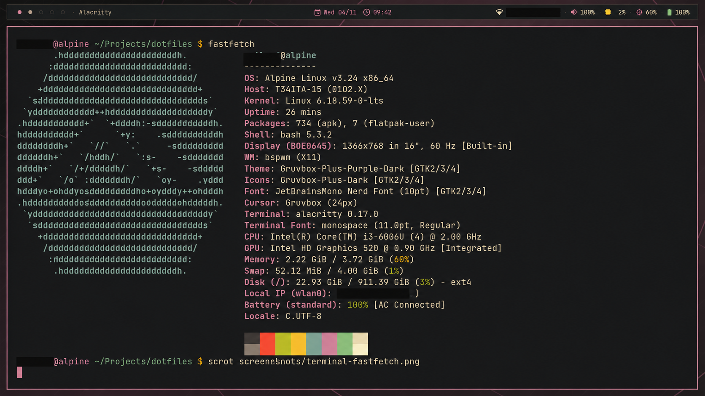

# Dotfiles

Estes são meus dotfiles.



## Requisitos

### Base
- xorg (xinit, xsetroot)
- dbus (dbus-run-session, dbus-daemon)
- setxkbmap
- feh
- pipewire
- pipewire-pulse
- wireplumber
- dunst
- bspwm
- sxhkd
- polybar
- gvim
- xclip
- shadow
- adwaita-icon-theme
- pavucontrol
- alacritty
- rofi
- font-jetbrains-mono (usado pelo polybar)
- vim (plugins via vim-plug, instale na primeira execução com `:PlugInstall`)
- nerd-fonts

### Aparência (opcional)
Para instalar o tema visual completo sem root:
- git
- curl
- unzip
- python3 (usado para ajustar a cor das pastas dos ícones)

O script `scripts/install-appearance.sh` instala no seu perfil:
- Tema GTK3 Gruvbox Plus com destaque roxo
- Ícones Gruvbox Plus com pastas roxas
- Cursores Capitaine Cursors (Gruvbox)

### Para uma melhor experiência
Para animações:
- picom
Para música:
- mpd
- mpc
- ncmpcpp

## Tema

O tema é o **Gruvbox Dark** com destaque em roxo (`#D3869B`). A paleta é aplicada em:
- Alacritty, Polybar, Dunst, Rofi e bordas do bspwm
- Vim (colorscheme `gruvbox-purple`) e Lightline
- Prompt do bash, cores do `ls` (quando `coreutils`/`dircolors` estiver disponível)
- GTK3/GTK4, ícones, cursores e wallpaper

O wallpaper fica em `~/Pictures/Wallpapers/gruvbox-purple.png` e pode ser regerado com:
```sh
python3 scripts/generate-wallpaper.py
```

## Instalação

O primeiro passo é instalar todos os pacotes.

### Alpine
```sh
doas apk update
doas setup-xorg-base
doas apk add polybar bspwm sxhkd feh pipewire pipewire-pulse \
        wireplumber dunst gvim vim xclip shadow adwaita-icon-theme \
        pavucontrol alacritty rofi font-jetbrains-mono nerd-fonts-all
# Opcional
doas apk add mpd mpc ncmpcpp picom
```

Depois disso, defina o bash como shell padrão e copie os arquivos de `home/`:
```sh
chsh -s $(which bash)
cp -af home/. ~/
```

Certifique-se de que os scripts são executáveis:
```sh
chmod +x ~/.xinitrc ~/.services.sh ~/.gservices.sh ~/.start.sh ~/.config/bspwm/bspwmrc ~/.config/bspwm/services.sh scripts/install-appearance.sh
```

Instale os assets visuais (sem root):
```sh
./scripts/install-appearance.sh
```

Atualize o cache de fontes:
```sh
fc-cache -fv
```

Em seguida, inicie a sessão gráfica com:
```sh
startx
```

O wallpaper é definido pelo bspwmrc a partir de `~/Pictures/Wallpapers/` (atualmente `gruvbox-purple.png`).

### Projetos de terceiros
- Tema GTK: https://github.com/SylEleuth/gruvbox-plus-gtk
- Pacote de ícones: https://github.com/SylEleuth/gruvbox-plus-icon-pack
- Cursores: https://github.com/sainnhe/capitaine-cursors (variante Gruvbox)
- Vim/lightline: https://github.com/morhetz/gruvbox (adaptado com destaque roxo)
- Wallpapers Gruvbox: https://gruvbox-wallpapers.pages.dev/
